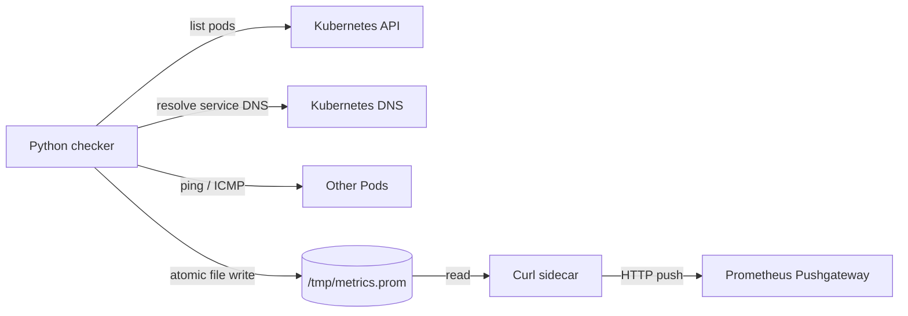

# Kubernetes Network Checker

A Kubernetes-native network diagnostics workload that verifies DNS resolution,
access to the Kubernetes API, and pod-to-pod connectivity. It runs scheduled
checks inside a cluster, exposes health and readiness endpoints, and pushes
Prometheus-compatible metrics to Pushgateway.

## Highlights

- Kubernetes in-cluster authentication
- Least-privilege Pod discovery with `ServiceAccount`, `Role`, and `RoleBinding`
- CoreDNS resolution check
- TCP connectivity check against the Kubernetes API
- ICMP pod-to-pod connectivity check
- Atomic metric file updates
- Pushgateway metric delivery through a sidecar
- Kubernetes liveness and readiness probes
- Kustomize and Argo CD deployment support
- Container image workflow designed for GHCR/Kubernetes workloads

## Architecture



The two containers share an `emptyDir` volume mounted at `/tmp`. The checker
writes metrics atomically; the sidecar reads the completed file and pushes it
at the configured interval.

The deployment does not expose an HTTP metrics Service or `/metrics` endpoint.
Prometheus should scrape the Pushgateway instead.

## Checks

| Metric | Prometheus test label | Success | Failure |
| --- | --- | --- | --- |
| DNS resolution | `core_dns_check` | Resolves `kubernetes.svc.cluster.local` | Metric value `0` |
| Kubernetes API | `cluster_api_check` | TCP connection to port `443` succeeds | Metric value `0` |
| Pod communication | `container_communication_check` | One ICMP packet reaches the target pod | Metric value `0` |

All checks produce metric values `1` or `0`.

Example:

```text
network_checker{test="core_dns_check",node_name="worker-1",name="network-checker"} 1
network_checker{test="container_communication_check",host_pod="network-checker",target_pod="api-pod",target_ip="10.42.1.8"} 1
```

Label values are escaped for the Prometheus text format.

## Repository Layout

```text
.
├── Dockerfile
├── network-checker.py
├── test_network_checker.py
├── k8s/
│   ├── checker.yaml
│   └── kustomization.yaml
└── argocd/
    └── application.yaml
```

- `network-checker.py` discovers pods and executes the checks.
- `test_network_checker.py` validates metric handling and Kubernetes client behavior.
- `k8s/checker.yaml` contains the workload, RBAC, and Pushgateway pusher.
- `k8s/kustomization.yaml` defines the namespace and container image.
- `argocd/application.yaml` defines the Argo CD application.

## How It Works

### Checker container

1. Loads Kubernetes credentials with `config.load_incluster_config()`.
2. Lists pods in the namespace received through the Kubernetes downward API.
3. Places the current checker pod first in the pod list.
4. Resolves Kubernetes DNS.
5. Opens a TCP connection to the Kubernetes API on port `443`.
6. Sends one ping to every discovered pod IP.
7. Writes the complete result set to `/tmp/metrics.prom.tmp`.
8. Atomically replaces `/tmp/metrics.prom`.
9. Repeats after the configured interval.

### Pusher sidecar

The sidecar reads `/tmp/metrics.prom` and sends it to:

```text
<PUSHGATEWAY_URL>/metrics/job/network-checker/namespace/<namespace>
```

The default endpoint is:

```text
http://pushgateway.monitoring.svc.cluster.local:9091
```

The endpoint and interval are stored in the `network-checker-pusher` ConfigMap.

## Health and Readiness

The checker server listens on port `8081`.

| Endpoint | Purpose | Response |
| --- | --- | --- |
| `/healthz` | Liveness | `200` while the process is running |
| `/readyz` | Readiness | `200` after the first successful check cycle; otherwise `503` |

`/metrics` is intentionally unavailable. Metrics are pushed instead of scraped.

## Configuration

The Deployment supplies these settings:

| Name | Location | Default | Purpose |
| --- | --- | --- | --- |
| `NAMESPACE_NAME` | Downward API | Deployment namespace | Target namespace for pod discovery |
| `POD_IP` | Downward API | Current pod status | Selects the local pod as ping source |
| `CHECK_INTERVAL_SECONDS` | Deployment | `60` | Interval between check cycles |
| `KUBERNETES_DNS_NAME` | Optional environment variable | `kubernetes.svc.cluster.local` | DNS name to resolve |
| `PUSHGATEWAY_URL` | ConfigMap | `http://pushgateway.monitoring.svc.cluster.local:9091` | Pushgateway base URL |
| `PUSH_INTERVAL_SECONDS` | ConfigMap | `60` | Interval between metric pushes |

Invalid `CHECK_INTERVAL_SECONDS` values fall back to `60` seconds.

## Kubernetes Prerequisites

- A running Kubernetes cluster
- `kubectl`
- Kustomize support or Argo CD
- Permission to create namespaces and workload resources
- A Pushgateway in a reachable Kubernetes namespace
- Permission to use `NET_RAW` where Pod Security enforcement requires it

The ServiceAccount needs `get` and `list` access to pods in the target namespace.
The Docker image also needs permission to run the `ping` binary, provided by
the `NET_RAW` capability.

## Kubernetes Deployment

1. Ensure the Pushgateway endpoint in `k8s/checker.yaml` is reachable.
2. Confirm the image name in `k8s/kustomization.yaml`.
3. Deploy with Kustomize:

```bash
kubectl apply -k k8s/
```

4. Verify the workload:

```bash
kubectl -n network-checker get pods
kubectl -n network-checker logs deployment/network-checker -c network-checker
kubectl -n network-checker logs deployment/network-checker -c metrics-pusher
```

The namespace and image are centralized in `k8s/kustomization.yaml`. If the
namespace is changed, update `destination.namespace` in
`argocd/application.yaml` as well.

## Argo CD Deployment

Register this repository with Argo CD, then apply:

```bash
kubectl apply -f argocd/application.yaml
```

The Application:

- Deploys resources from `k8s/`
- Creates the target namespace
- Enables automated pruning
- Enables self-healing

Never commit Argo CD repository credentials or Kubernetes secrets.

## Container Image

The image is an Alpine-based Python image with `iputils` and the Kubernetes
Python client.

```text
ghcr.io/norod-boop/network-checker
```

It is designed exclusively for Kubernetes execution and requires in-cluster
service-account credentials.

For a private image, configure `spec.template.spec.imagePullSecrets` in the
Deployment or through a Kustomize overlay.

## Local Validation

The repository includes focused unit tests:

```bash
python3 -m unittest -v test_network_checker.py
python3 -m py_compile network-checker.py test_network_checker.py
```

No Kubernetes cluster is required for these unit tests. Full network behavior,
RBAC, probes, and Pushgateway delivery require a running cluster.

## Security

- Runs with a dedicated `ServiceAccount`.
- Uses namespace-scoped Pod read permissions.
- Disables privilege escalation.
- Drops Linux capabilities except `NET_RAW`.
- Writes metrics only to a pod-local `emptyDir` volume.
- Uses no Kubernetes tokens or credentials in source files.

Restricted Kubernetes clusters may reject `NET_RAW`. In that case, pod ping
checks cannot run unless the cluster explicitly permits the workload.

## Known Limitations

- This is a connectivity probe, not a complete Kubernetes network policy audit.
- A ping result proves reachability from the checker pod to the target pod.
- Kubernetes API checks assume standard TCP port `443`.
- The Pushgateway must be deployed and reachable.
- Pushgateway data can remain stale until a successful push replaces it.
- Multiple checker pods are not supported by the default `replicas: 1` setup;
  scaling would require per-pod Pushgateway grouping to avoid data collisions.

## License

Add a license before publishing publicly if reuse or contribution is intended.
